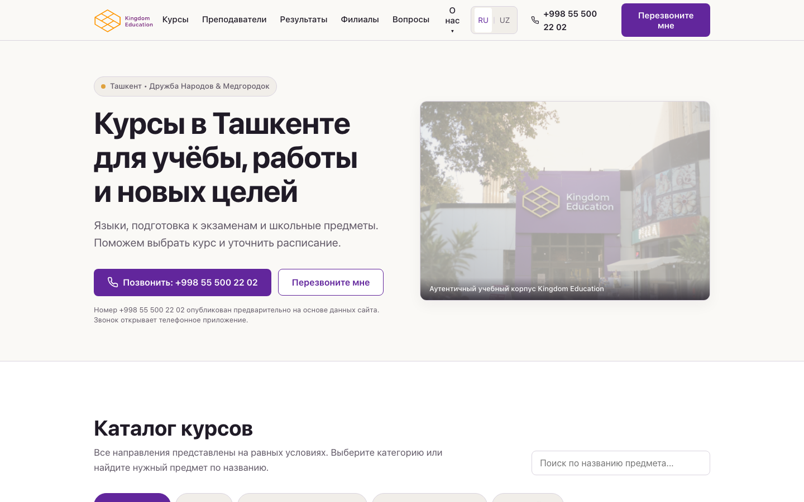
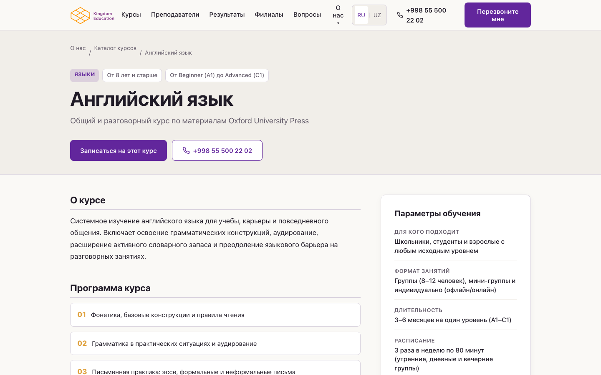
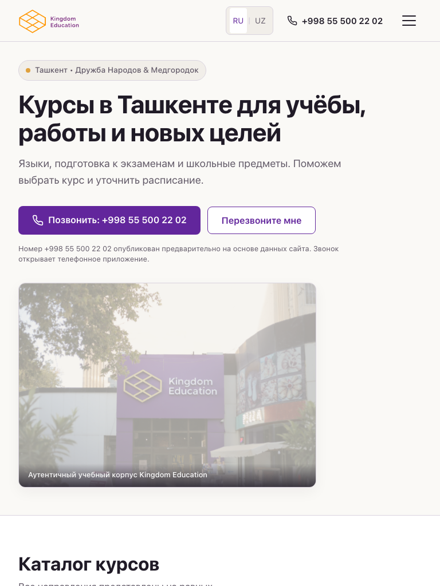
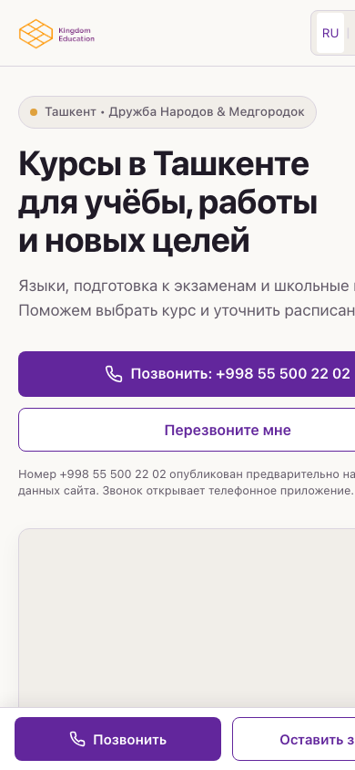

# 🏛️ Kingdom Education — Official Web Platform

<div align="center">

[](https://react.dev/)
[](https://www.typescriptlang.org/)
[](https://vitejs.dev/)
[](https://reactrouter.com/)
[](https://www.w3.org/WAI/standards-guidelines/wcag/)
[](#-bilingual-architecture-ru--uz)

**A high-conversion, accessible web platform for Kingdom Education — a premier learning center in Tashkent, Uzbekistan operating since 2016.**

[Live Preview](#-quick-start) • [Design System](#-design-system--tokens) • [Course Directory](#-course-inventory--equal-priority) • [Architecture](#-project-architecture) • [Launch Checklist](#-pre-launch-verification-register)

</div>

---

## 📖 Overview

This repository houses the modern redesign of **Kingdom Education** (`kingdomedu.uz`), designed strictly according to the conversion and aesthetic contract defined in [`design.md`](./design.md) and [`prompt.md`](./prompt.md).

The platform helps students, parents, and working professionals in Tashkent explore available programs, understand academic credibility through verified evidence, and take immediate contact action.

### 🎯 Key Design & Conversion Principles

1. **Equal Visual Opportunity**: All 13 courses have equal visual weight. No single course (such as IELTS or English) is given artificial commercial preference.
2. **Warm Editorial Aesthetic**: Inspired by humanist editorial design principles (warm cream canvas `#FAF9F6`, deep purple actions `#62269C`, and restrained gold accents `#DFA13D`).
3. **Evidence-First Content**: Zero marketing fluff, no fabricated testimonials, no unsupported "best in Tashkent" claims. Real verified instructors, real documented scores, and authentic campus photography.
4. **Frictionless Inquiries**: Direct phone calls (`tel:+998555002202`), quick callbacks with auto-formatting for Uzbek telephone numbers, and an honest sandbox test mode.
5. **Legacy URL Preservation**: Seamless routing for existing indexed links (e.g., `/kurses.html`, `/kurs-single.html`, `/about.html`, `/contacts.html`).

---

## 📸 Interface Previews

<div align="center">

### Desktop Viewport (1440px)


### Course Details Viewport (1440px)


</div>

<br />

| Tablet Layout (768px) | Mobile Layout (390px) |
| :---: | :---: |
|  |  |

---

## ✨ Features & User Journeys

### 🎓 Course Inventory & Equal Priority
* **Goal-based filtering**: Categories include *Languages*, *Exam Preparation*, *School Subjects*, and *Children*.
* **Alphabetical sorting by active locale**: The catalog auto-sorts in Russian or Uzbek alphabetically to ensure no subject receives unfair prominence.
* **Instant search**: Filter by course title or keywords with real-time feedback and an honest no-results reset button.
* **Dedicated detail pages**: Every single course features its own route with target audience, format, duration, syllabus modules, entrance criteria, and teacher cards.

| Category | Courses Included |
| :--- | :--- |
| **Languages (Tillar)** | General English, Russian, Turkish, Korean, Chinese |
| **Exam Prep (Imtihonlar)** | IELTS Academic (7.5+ instructor), Digital SAT (Math & Verbal) |
| **School Subjects (Maktab)** | Mathematics, Chemistry, Biology, History |
| **Children (Bolalar)** | Chess (5+ years), Pochemuchka (School readiness 4–6 years) |

---

### 📞 Contact & Callback Contract
* **Provisional Verified Phone**: `+998 55 500 22 02` rendered with semantic `tel:` link across hero, header, branches, and sticky bars. Tapping opens the phone dialer; it never auto-calls.
* **Smart Phone Normalization**: Input automatically formats Uzbek numbers (`+998 (XX) XXX-XX-XX`) as the user types or pastes.
* **Inline Validation**: Friendly validation triggers on field exit (`blur`), clearing errors immediately as typing resumes.
* **Sandbox & Live Mode**: Includes an interactive sandbox toggle allowing developers and stakeholders to preview both **Confirmed Delivery** (`✓`) and **Actionable Network Error** (`✕`) states without spamming real CRM systems.
* **Mobile Sticky Action Bar**: Fixed bottom bar featuring filled *Call* and outlined *Callback* buttons with safe-area padding (`env(safe-area-inset-bottom)`) that automatically suppresses when modal dialogs are open.

---

### 🌐 Bilingual Architecture (RU / UZ)
* **Explicit Language Switcher**: Visible RU / UZ controls in the header.
* **Synchronized State**: Stored in `localStorage` and automatically sets `<html lang="ru|uz">` for screen readers and search engines.
* **Structured Dictionary**: Centralized in [`src/data/content.ts`](./src/data/content.ts), avoiding scattered strings and allowing rapid updates or professional fluent review.

---

### ⚡ Emil Kowalski Motion Standards
* **Interaction Timing**: Sub-`200ms` enter durations, `150ms` exit durations with custom easing:
  ```css
  --ease-out: cubic-bezier(0.23, 1, 0.32, 1);
  ```
* **No Layout Thrashing**: Animations are strictly restricted to `transform` and `opacity`.
* **Instant FAQ**: FAQ accordions utilize native `<details>` and `<summary>` elements with zero height tween delay.
* **Prefers-Reduced-Motion**: Fully honors OS accessibility preferences by resetting animations to instantaneous execution.

---

## 🎨 Design System & Tokens

All tokens are defined in [`src/index.css`](./src/index.css) as CSS custom properties:

```css
:root {
  /* Surfaces & Canvas */
  --canvas:         #FAF9F6;  /* Warm cream page background */
  --surface:        #FFFFFF;  /* Cards, modals, inputs */
  --surface-muted:  #F1EEE9;  /* Secondary sections & chips */

  /* Typography & Text */
  --text:           #201B27;  /* Deep charcoal for body & headings */
  --text-muted:     #625A68;  /* Supporting copy & metadata */
  --border:         #DAD4DF;  /* Functional borders & inputs */

  /* Actions & Accents */
  --action:         #62269C;  /* Primary brand purple */
  --action-hover:   #4C1C7A;  /* Hover / active state */
  --brand-gold:     #DFA13D;  /* Logo highlights & badge accents */
  --focus:          #62269C;  /* Accessible 3px outline with 3px offset */
  --error:          #B42318;  /* Form validation errors */
}
```

### 📐 Spacing & Rhythm
* **Scale**: `4px`, `8px`, `12px`, `16px`, `24px`, `32px`, `48px`, `64px`, `96px`
* **Container Max Width**: `1200px` (Responsive side padding: `20px` mobile, `32px` tablet, `48px` desktop)
* **Radii**: Controls `8px`, Content Cards `12px`
* **Touch Targets**: Minimum `44×44px` across all clickable elements; contact buttons at least `48px` high.

---

## 📂 Project Architecture

```text
kingdom_edu/
├── public/
│   ├── about.jpg               # Authentic classroom & building photo
│   ├── logo.png                # Official geometric Kingdom logo
│   ├── footerlogo.svg          # High-contrast footer logo asset
│   ├── t1.png                  # Verified instructor portrait (Isoqov Shaxriyor)
│   ├── student-anvarov.png     # Documented IELTS 7.5 graduate result
│   └── screenshots/            # Device viewports for QA (1440, 768, 390, 320)
├── src/
│   ├── components/             # Reusable accessible UI components
│   │   ├── Header.tsx          # Nav, language switcher, mobile drawer
│   │   ├── Hero.tsx            # Offer headline, verified call CTA, photo
│   │   ├── CourseFinder.tsx    # Equal-opportunity catalog & filter
│   │   ├── Results.tsx         # Documented stories with exam disclaimers
│   │   ├── TeachersProcess.tsx # Verified faculty & 3-step learning methodology
│   │   ├── Branches.tsx        # Physical branch tabs & lazy-loaded maps
│   │   ├── FAQ.tsx             # Native accessible accordion
│   │   ├── CallbackForm.tsx    # Phone normalization, inline errors, sandbox mode
│   │   ├── MobileContactBar.tsx# Fixed bottom bar for touch devices
│   │   └── Footer.tsx          # Clean site directory & legal disclaimers
│   ├── data/
│   │   └── content.ts          # Single source of truth for all structured data
│   ├── i18n/
│   │   └── I18nContext.tsx     # Context hook for RU/UZ locale switching
│   ├── pages/                  # Route entry points
│   │   ├── HomePage.tsx        # Homepage sequence from design.md
│   │   ├── CoursesPage.tsx     # Standalone course directory
│   │   ├── CourseDetailPage.tsx# Unique course routes (/courses/:slug)
│   │   ├── AboutPage.tsx       # Institutional history & values
│   │   ├── CorporatePage.tsx   # Corporate training (B2B)
│   │   ├── KindergartenPage.tsx# Kingdom Kindergarten at Medgorodok
│   │   ├── VacanciesPage.tsx   # Verified career openings
│   │   └── ContactsPage.tsx    # Branch addresses & call center lines
│   ├── App.tsx                 # Route mappings & modal manager
│   ├── index.css               # Design tokens, typography, resets
│   └── main.tsx                # Application bootstrap
├── design.md                   # Complete design and conversion contract
├── prompt.md                   # Project requirements and constraints
└── package.json
```

---

## 🚀 Quick Start

### Prerequisites
* **Node.js**: v18.0.0 or higher (v24+ recommended)
* **npm**: v9.0.0 or higher

### Installation

```bash
# 1. Clone or enter the workspace
cd kingdom_edu

# 2. Install dependencies
npm install

# 3. Start local development server with HMR
npm run dev
```

Visit `http://localhost:5173` in your browser.

### Production Build & Preview

```bash
# Check TypeScript types and build optimized bundle
npm run build

# Preview the production build locally
npm run preview
```

The production bundle will be served at `http://localhost:4173`.

---

## 📋 Pre-Launch Verification Register

Per [`design.md`](./design.md) and [`prompt.md`](./prompt.md), the following operational facts must be confirmed by the center's ownership prior to live deployment:

| Item | Current Status | Action Needed Before Live Deployment |
| :--- | :--- | :--- |
| **Hotline Phone** | Provisionally set to `+998 55 500 22 02` | Business ownership confirmation. |
| **Official Email** | Placeholder `contact@codingninjas.com` removed | Confirm official company mailbox (e.g. `info@kingdomedu.uz`). |
| **Branch Addresses** | Deduplicated Furkat 11-A/15-A & Kamarniso 12-D | Confirm legal suite and street numbers. |
| **Pricing Policy** | Set to "Inquire by phone" | Business decision: maintain phone quote or publish fixed tiers. |
| **CRM Integration** | Sandbox Mock API Active | Supply real CRM webhook/endpoint credentials. |
| **Uzbek Copy** | Written and structured | Fluent native speaker sign-off before official launch. |

---

## ♿ Accessibility & Quality Standards

- **Keyboard Navigation**: Complete tab order across menu, course filters, dialogs, and forms.
- **Focus Rings**: Non-intrusive 3px solid focus ring with 3px offset.
- **Form Semantics**: Explicit labels associated with `for`/`id`, `autocomplete="tel"`, and `aria-describedby` error announcements.
- **No Orphan CTAs**: No `#` links or broken anchors. Every button triggers a real route or functional dialog.
- **Responsive Layout**: Zero horizontal overflow verified across 320px, 390px, 768px, and 1440px viewports.

---

## 📄 License & Attribution

* **Brand Assets & Photography**: © Kingdom Education (OOO "YOUR FIRST STEP", Tashkent). All rights reserved.
* **Code Implementation**: Designed and developed according to the Kingdom Education conversion brief.
